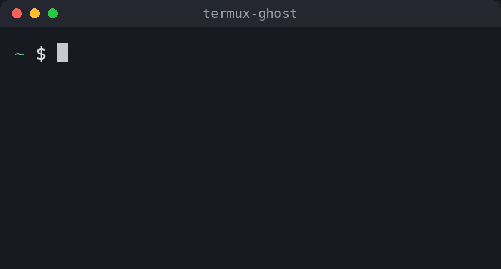

# termux-ghost

[English](README.md) | **العربية**

اقتراحات تلقائية من سجل الأوامر لصدفة Bash على ترمكس، تعمل مثل `zsh-autosuggestions`.
مكتوبة بلغة C وتعمل داخل Bash مباشرة عبر مكتبة readline، بلا عمليات خارجية عند كل حرف.

## التثبيت

    pkg install git
    git clone https://github.com/stonxmg-lang/termux-ghost
    cd termux-ghost
    ./install.sh

ثم افتح جلسة جديدة. يبني السكربت الإضافة على جهازك، ويثبّت `clang` و`make` و`readline` إن لم تكن موجودة.

الإزالة: `./install.sh --uninstall`

## الاستخدام

| المفتاح | الوظيفة |
|---|---|
| `→` أو `End` أو `Ctrl-E` أو `Ctrl-F` | قبول الاقتراح كاملًا |
| `Alt + →` أو `Ctrl + →` أو `Alt-F` | قبول الكلمة التالية فقط |

| الأمر | الوظيفة |
|---|---|
| `ghost on` / `ghost off` | تشغيل أو إيقاف |
| `ghost status` | عرض الحالة |
| `ghost color 38;5;244` | تغيير لون الاقتراح (رموز SGR) |

الأوامر تسري على الجلسة الحالية فقط. لتثبيت لون، أضف أمر `ghost color` إلى `~/.bashrc` بعد سطر التحميل.

الاقتراحات تأتي من السجل المحمّل في الجلسة، وحجمه يحدده `HISTSIZE` و`HISTFILESIZE`.

## التوافق

تعمل مع Bash فقط، وليس مع Zsh أو Fish.

جُرّبت على: ترمكس، Android 16، aarch64، Bash 5.3، readline 8.3. لم تُجرَّب بعد على إصدارات أو معماريات أخرى، لكنها تُبنى على جهازك نفسه. إذا تعذّر تحميلها تعمل الصدفة عادي دون اقتراحات.

## الاختبارات

    tests/run.sh

تعمل في طرفية حقيقية عبر tmux، بسجل مؤقت لا يمس سجلك.

تحتاج `tmux`.

## الرخصة

MIT
