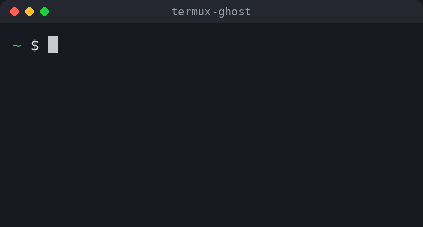

# termux-ghost

**English** | [العربية](README.ar.md)

Fish-style history autosuggestions for **Bash on Termux**, like `zsh-autosuggestions`.

As you type, the most recent matching command from your history appears in dim text after the cursor. Press `→` to accept it.



## Why

Most autosuggestion setups for Bash run shell code on every keystroke. On a phone, that adds lag.

termux-ghost is a small C library that loads straight into Bash as a [loadable builtin](https://www.gnu.org/software/bash/manual/html_node/Bash-Builtins.html#index-enable) and hooks GNU Readline from the inside:

- **No forks, no shell code per key.** The suggestion is drawn inside Readline's own redisplay.
- **Cached search.** If you keep typing and the suggestion still matches, history is not scanned again.
- **Phone friendly.** It handles long lines that wrap on a narrow screen, wide characters (Arabic, CJK), pasting, Ctrl-C and screen resizes, and it binds the keys that Termux's extra-keys row sends.
- **Clean exit.** `enable -d ghost` puts every hook back, so Bash behaves exactly as it did before.

## Install

```sh
pkg install git
git clone https://github.com/stonxmg-lang/termux-ghost
cd termux-ghost
./install.sh
```

Then open a new session. The script builds the library on your device and installs `clang`, `make` and `readline` if they are missing. It adds one line to `~/.bashrc`.

Uninstall: `./install.sh --uninstall`

## Usage

| Key | Action |
|---|---|
| `→`, `End`, `Ctrl-E` or `Ctrl-F` | Accept the whole suggestion |
| `Alt-→`, `Ctrl-→` or `Alt-F` | Accept the next word only |

If there is no suggestion, these keys work as usual. Keys you have rebound to the same actions in `~/.inputrc` work too, and so does vi insert mode.

| Command | Action |
|---|---|
| `ghost on` / `ghost off` | Turn suggestions on or off |
| `ghost status` | Show whether it is on |
| `ghost color 38;5;244` | Change the suggestion colour ([SGR codes](https://en.wikipedia.org/wiki/ANSI_escape_code#SGR_(Select_Graphic_Rendition)_parameters), default `90`) |

These commands apply to the current session. To keep a colour, add `ghost color ...` to `~/.bashrc` after the line the installer added.

Suggestions come from the history loaded in the session, so their range is set by `HISTSIZE` and `HISTFILESIZE`. They only appear when the cursor is at the end of the line, and not during reverse search, tab completion, multi-line (`PS2`) input or `read -e`.

## Compatibility

Bash only. Zsh and Fish already have this feature built in or available as a plugin.

Tested on Termux, Android 16, aarch64, Bash 5.3, Readline 8.3. It is built on your own device, so other versions are likely to work but have not been tested. If it fails to load, your shell starts normally without suggestions.

## Tests

```sh
tests/run.sh
```

The tests drive a real terminal through `tmux` with a throwaway history file, so your own history is not touched. They need `tmux` (`pkg install tmux`).

## License

[MIT](LICENSE)
